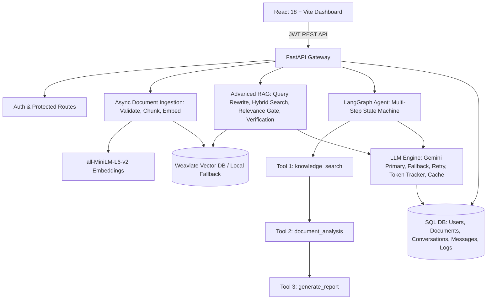

# AI-Powered Enterprise Intelligence Platform

Production-ready enterprise intelligence system that processes internal knowledge, answers complex multi-document questions with source citations, and executes multi-step analytical reasoning via a LangGraph state machine.

Built with **FastAPI**, **React (Vite)**, **Google Gemini (`google-genai`)**, **LangGraph**, **Weaviate Vector DB**, **Sentence-Transformers/MiniLM**, and **SQLAlchemy**.

---

## 1. Quick Start

### Prerequisites
- Python 3.11+
- Node.js 18+

### Setup & Run
1. **Virtual Environment & Dependencies:**
   - The virtual environment is created at `D:\Desktop\ai_project\venv` (or via `.\setup.ps1`).
   - Backend dependencies: `pip install -r backend/requirements.txt`
   - Frontend dependencies: `cd frontend && npm install`
2. **Environment Configuration:**
   - Copy `backend/.env.example` to `backend/.env` (already created).
   - Enter your `GEMINI_API_KEY` (and optional `WEAVIATE_URL` & `WEAVIATE_API_KEY` for Weaviate Cloud).
   - *Note:* If Weaviate credentials are not provided, the platform automatically falls back to an ultra-fast local hybrid vector store so you can upload and test immediately without cloud setup.
3. **Run the Application:**
   ```powershell
   # Start both Backend and Frontend with a single command:
   powershell -ExecutionPolicy Bypass -File .\run.ps1
   ```
   Or launch separately:
   - **Backend:** `cd backend; D:\Desktop\ai_project\venv\Scripts\uvicorn.exe app.main:app --reload --port 8000`
   - **Frontend:** `cd frontend; npm run dev`
4. **Access the Live Platform:**
   - **Frontend UI:** [http://localhost:5173](http://localhost:5173)
   - **Interactive Swagger / OpenAPI Docs:** [http://localhost:8000/docs](http://localhost:8000/docs)
   - **Alternative ReDoc:** [http://localhost:8000/redoc](http://localhost:8000/redoc)
   - **Dependency Health Check:** [http://localhost:8000/health/deps](http://localhost:8000/health/deps)

---

## 2. System Architecture



---

## 3. Mandatory Functional Modules (A - G)

| Module | Description | Implementation Details |
|---|---|---|
| **A. Document Intelligence** | Multi-format upload, deduplication, chunking, embeddings | Supports PDF (`pypdf`), Markdown, TXT, and CSV. SHA-256 deduplication per user. Asynchronous background chunking with sliding-window overlap (`CHUNK_SIZE=800`, `CHUNK_OVERLAP=120`). Document-level retrieval and lifecycle status tracking (`pending`, `processing`, `ready`, `failed`). |
| **B. Advanced RAG Architecture** | Hybrid retrieval, citations, relevance gate, conflict handling | Dense embeddings via `all-MiniLM-L6-v2` fused with BM25 keyword matching (`HYBRID_ALPHA=0.6`). Cosine relevance gate (`MIN_RELEVANCE=0.25`) drops irrelevant chunks to prevent hallucinations without LLM cost. Explicit source citations (`[n]`) and conflicting source detection. |
| **C. LLM Integration** | Multi-provider fallback, structured output, token tracking | Official `from google import genai` SDK. Primary model `gemini-3.5-flash` with automatic fallback to secondary model `gemini-2.5-flash` upon 429 rate-limiting, 5xx outages, or JSON schema violations. Token consumption tracking and TTLCache cost optimization. |
| **D. AI Agents** | LangGraph cyclical agent with tool chaining | Cyclical state graph with 3 functional tools: `knowledge_search`, `document_analysis`, and `generate_report`. Demonstrates true multi-step chaining where search output feeds analysis, which feeds structured report generation. Step budget limit (`AGENT_MAX_STEPS=6`), per-tool timeout (`TOOL_TIMEOUT_S=60`), and visible step trace. |
| **E. Conversational Memory** | User-specific conversation context and rolling summary | Multi-conversation management with user isolation. Retains last `N=6` messages combined with a rolling LLM-generated background summary of older turns, avoiding context explosion. |
| **F. Application Dashboard** | React frontend with metrics, document manager & chat | User registration, login, and JWT persistence. Document upload with live processing polling. Interactive chat supporting both RAG and Agent modes. Agent step timeline visualization, source citations card with relevance score, token metrics, and activity logs. |
| **G. AI Evaluation** | 22-question benchmark and LLM-as-judge harness | Automated evaluation script (`backend/eval/run_eval.py`) testing retrieval hit rate, correctness, grounding, hallucination handling, latency, and tokens across 22 questions (`backend/eval/dataset.json`). |

---

## 4. Advanced Engineering Challenges Implemented

1. **Intelligent Model Fallback:** Automatically switches from primary model `gemini-3.5-flash` to secondary model `gemini-2.5-flash` with exponential backoff on retryable HTTP codes (429, 500, 502, 503, 504) and JSON validation errors.
2. **Prompt Injection Protection:** Retrieved document contents are treated as untrusted data, sanitized for injection keywords (`"ignore all previous instructions"`, `"reveal system prompt"`), and strictly enclosed inside boundary-checked `<sources>` blocks in `security.py`.
3. **Retrieval Optimization:** Hybrid search combines BM25 keyword precision for error codes and technical IDs with dense vector semantic search, followed by cosine relevance thresholding and semantic query rewriting for follow-up questions.
4. **AI Response Verification:** A dedicated verification prompt scores whether candidate statements are supported by the retrieved document chunks, returning confidence scores and flagging unsupported claims.
5. **Cost Optimization:** LRU/TTL caching (`cachetools`) avoids redundant LLM invocations for identical prompts. Full token accounting (`prompt_tokens`, `completion_tokens`, `total_tokens`) is recorded per query in the database.
6. **Asynchronous Document Processing:** Uploads return `202 Accepted` immediately, delegating parsing, chunking, and vector indexing to background workers (`BackgroundTasks`) with atomic status tracking.
7. **Agent Reliability:** Enforces Pydantic argument validation, step budget caps, per-tool timeouts (`ThreadPoolExecutor`), duplicate tool-call prevention, and graceful recovery when tools return validation errors.

---

## 5. Automated Tests

Run the full offline test suite (no external API keys or remote services required):
```powershell
powershell -ExecutionPolicy Bypass -File .\test.ps1
```
Or directly via pytest:
```powershell
cd backend
D:\Desktop\ai_project\venv\Scripts\python.exe -m pytest -v
```
**Results:** `11 passed in 9.49s` covering authentication, duplicate hash detection, document isolation, chunking, prompt injection sanitizer, RAG refusal, citations, model fallback, LangGraph multi-step tool chaining, and conversational memory.

---

## 6. AI Evaluation Benchmark

To run the automated 22-question evaluation harness against the live API:
```powershell
cd backend
D:\Desktop\ai_project\venv\Scripts\python.exe -m eval.run_eval --base http://localhost:8000
```
Detailed results, methodology, and limitations are documented in [`docs/EVALUATION_REPORT.md`](file:///D:/Desktop/ai_project/ai-platform/docs/EVALUATION_REPORT.md).

---

## 7. Cloud Deployment Guide

- **Database:** Supabase PostgreSQL (Session Pooler URL) set as `DATABASE_URL`.
- **Vector Database:** Weaviate Cloud sandbox set via `WEAVIATE_URL` and `WEAVIATE_API_KEY`.
- **Backend (Render / Railway):**
  - Root directory: `backend`
  - Build command: `pip install -r requirements.txt`
  - Start command: `uvicorn app.main:app --host 0.0.0.0 --port $PORT`
  - Environment variables: `GEMINI_API_KEY`, `WEAVIATE_URL`, `WEAVIATE_API_KEY`, `DATABASE_URL`, `FRONTEND_URL`.
- **Frontend (Vercel):**
  - Root directory: `frontend`
  - Build command: `npm run build`
  - Output directory: `dist`
  - Environment variable: `VITE_API_URL=<Render Backend URL>`.
